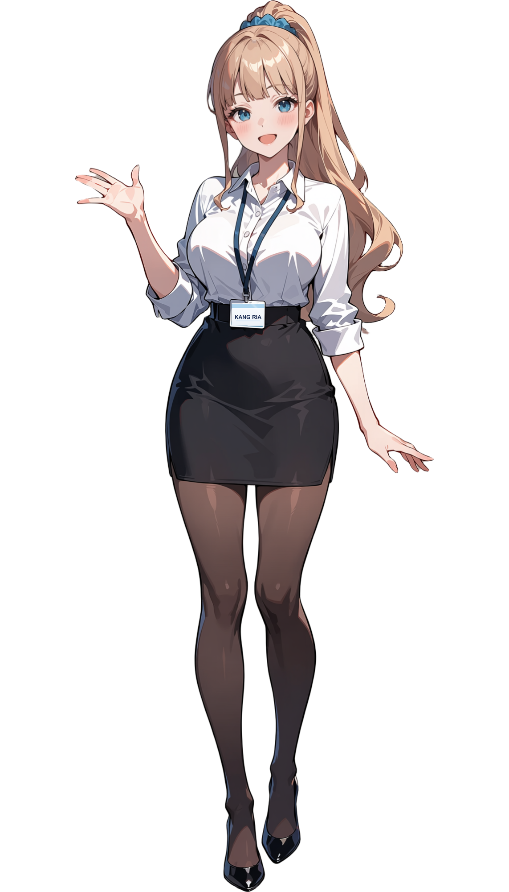
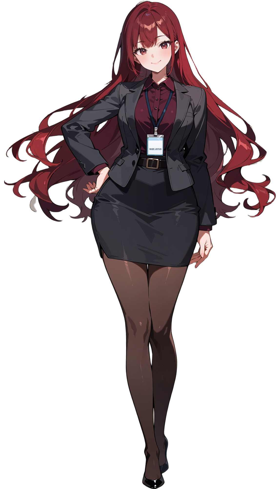
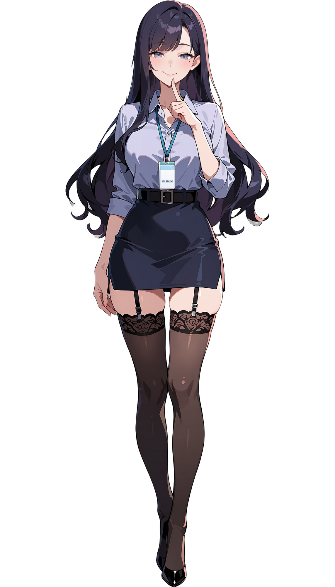
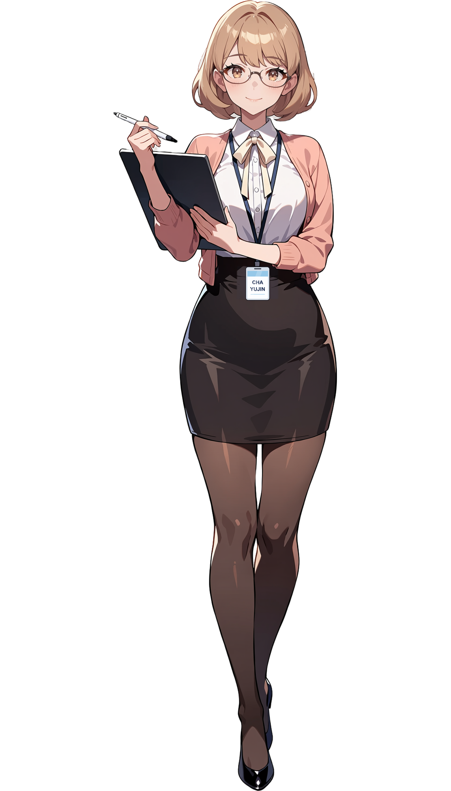

# 현행 캐릭터 외형 기준 · 2026-11-14 (v003)

2026-11-13 사용자 결정으로 아래 **오피스룩 마스터 후보 v001 네 장**을 네 히로인의 **얼굴·헤어·체형·업무복·소품·공통 그림체 기준**으로 지정한다. 이전 타이틀 v002·개별 마스터·의상 제안·CG와 외형이 충돌하면 이 네 장과 이 문서를 우선한다. 성격·나이·직무·말투·관계·대본은 바꾸지 않는다.

| 강리아 | 백지현 | 한서윤 | 차유진 |
|---|---|---|---|
|  |  |  |  |

## 원본과 식별

- 폴더: [candidates/heroine-masters-v001](candidates/heroine-masters-v001/README.md)
- 형식: 투명 PNG(RGBA), 1143×2000, 머리 꼭대기~신발 끝이 캔버스 높이 전체
- 제작: 로컬 ComfyUI, Anima Turbo 1.1, 화풍 기준 그림 `candidates/user-uploads/강리아 마스터.png`(IP-Adapter, 2차 다듬기에만 적용)
- 생성 seed: 강리아 1002, 백지현 1002, 한서윤 1003, 차유진 1103
- 후처리: 얼굴 1024 확대 재묘사, ToonOut 누끼와 테두리 정리, 사원증 카드 무늬 제거 후 영어 이름 표기

## 인물별 고정 요소

| 인물 | 얼굴·헤어 | 현행 업무복·소품 |
|---|---|---|
| [강리아](character_art_02_RIA.md) | 갸름한 얼굴, 아주 긴 웨이브 금발 높은 포니테일, **파란 슈슈**, 일자 앞머리, **파란 눈**, 밝게 웃는 입 | 비치지 않는 흰 면 칼라 블라우스·접어 올린 소매, 검정 하이웨이스트 펜슬 스커트, 비치는 검정 팬티스타킹, 검정 에나멜 펌프스, 남색 사원증 |
| [백지현](character_art_03_JIHYUN.md) | 아주 긴 크림슨 웨이브, 옆 가르마 앞머리, 붉은 갈색 눈과 자신감 있는 눈매, 매력점 없음 | 버건디 셔츠, 차콜 테일러드 재킷, 차콜·검정 하이웨이스트 **펜슬 스커트**와 검정 벨트·작은 직사각 버클, 비치는 검정 팬티스타킹, 검정 스틸레토, 남색 사원증 |
| [한서윤](character_art_05_SEOYUN.md) | 갸름한 계란형 얼굴, 짙은 플럼·검보라 긴 웨이브, 반쯤 감은 회청·라벤더 눈, **왼쪽 눈 아래 매력점** | 연라벤더 칼라 블라우스·접은 소매·윗단추 하나 풂, 남색 하이웨이스트 펜슬 스커트와 검정 벨트, **가터벨트+검정 레이스 밴드 니삭스**, 검정 펌프스, 남색 사원증 |
| [차유진](character_art_04_YUJIN.md) | 갸름한 성인 얼굴, **베이지 금발 단발**(끝이 안으로 말림), 옆으로 넘긴 앞머리, **얇은 검정 사각 안경**, 호박색 눈 | 브랜드디자이너. 흰 칼라 블라우스와 크림색 목 리본, **더스티 핑크 긴소매 카디건**(앞 열림), 검정 하이웨이스트 펜슬 스커트, 비치는 검정 팬티스타킹, 검정 펌프스, **드로잉 태블릿과 스타일러스**, 남색 사원증 |

네 명의 눈·턱·가르마·체형을 한 얼굴로 통일하지 않는다. 색은 생성 결과의 관찰값이며 임의 HEX 값으로 대체하지 않는다.

## 타이틀 v002 대비 바뀐 점 (사용자 결정, 2026-11-13)

- 네 명 모두 스타킹을 신는다. 백지현은 바지 대신 펜슬 스커트.
- 강리아: 큰 남색 리본·녹청색 눈 → 파란 슈슈·파란 눈(기존 강리아 마스터 그림 기준).
- 한서윤: 매력점을 넣고 가터벨트·레이스 니삭스로 바꿨다.
- 차유진: 따뜻한 갈색 보브 → 베이지 금발 단발·안경. 분홍 카디건·목 리본은 유지하고, 디자이너 직업에 맞춰 드로잉 태블릿·스타일러스를 든다(2026-11-14, 비서룩 안을 대체).
- 사원증 카드에 영어 이름(KANG RIA / BAEK JIHYUN / HAN SEOYUN / CHA YUJIN)을 쓴다. 사진·로고는 넣지 않는다.

## 공통 유지·미확인 범위

- 네 명 모두 27~32세 성인 직장인. 어려 보이는 둥근 얼굴·짧은 등신·로퍼 같은 요소를 기본 외형에 넣지 않는다.
- 귀걸이·피어싱·임의 반지·목걸이를 추가하지 않는다. 사원증은 남색 스트랩과 밝은 홀더 한 개다.
- 강리아 외 히로인을 강리아 체형 비율에 맞추지 않는다. 제작 워크플로의 "강리아 비율 맞춤"은 강리아만 쓴다.
- 손 검수, 최종 규격 2048×3072, 표정 차분, 레이어 분리는 아직 하지 않았다. 마스터 v001은 외형 기준이며 게임 입상 완성본이 아니다.
- 얼굴·머리·손·의상을 재해석하지 않고 마스터의 선화·명암·하이라이트를 따른다. 배경도 같은 화풍으로 제작한다.

## 이전 기준

- [타이틀 v002](assets/title/title_escalator_jihyun_arm_lowered_v002.png)(2026-11-04 지정, [타이틀 기록](TITLE_CURRENT.md))은 이전 외형 기준으로 보존한다. 타이틀 화면 자체를 다시 만들 때는 위 마스터 외형에 맞춘다.
- 2026-11-06 삭제한 이전 개별 마스터·CG·후보 원화는 [삭제 명세](../Docs/production-review-v001/art-reset.json)와 Git 이력으로 추적한다. 과거 의상에서 신발·머리 장식 등을 자동 수입하지 않는다.

후속 제작은 위 마스터를 직접 참조한다. 입상은 [레이어 규격](character_art_08_LAYERS.md), 생성은 [참조 기록](character_art_06_PROMPT.md), 검수는 [QA 양식](character_art_07_QA.md)을 따른다.
