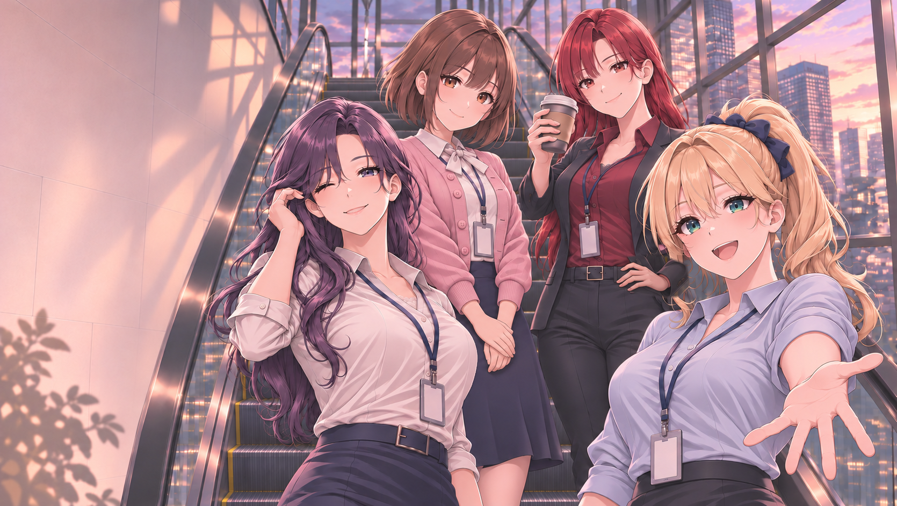

# 타이틀 키 비주얼 · 2026-11-04

현재 보관본: [title_escalator_hands_ria_eyes_v001.png](assets/title/title_escalator_hands_ria_eyes_v001.png)

## 반영 내용
- 차유진의 손 자세·작화와 강리아의 첫 원본 기준 눈화장을 함께 수정한 `exec-65164c88-69aa-43ce-a436-fb7bf4009e53.png`를 기준으로 사용.
- 후속 사용자 정정에 따라 강리아의 머리 모양·포니테일·남색 머리 리본과 차유진의 얼굴·턱선을 기준 원본에서 유지.
- 차유진 머리 옆 아이보리 리본 제거. 흰 블라우스 목 리본은 유지.
- 백지현의 허리 위 손에 이어지는 손목·재킷 소매를 복원하고 주변 작화에 맞춰 명암과 접촉을 정리.
- 생성 결과의 국소 수정 부위만 기준 원본에 합성. 차유진 턱선 영역과 강리아의 얼굴·주요 머리 영역은 원본과 픽셀 동일 확인. 팔과 겹치는 아래쪽 머리카락 경계는 함께 보정.

## 파일 정보
- 형식: PNG, RGB
- 실제 크기: 1670 × 942
- 크기: 3570118 bytes
- SHA-256: `0a868163c9949ba562308ebbed33fac4423813d3afeb9d044debdf36ed3b834f`
- Git blob SHA: `73e4204815eaa11bbf1e57f434b5079095d382a5`
- 제작: 참조 이미지 기반 생성 도구 편집 후 국소 합성. 도구가 모델명을 제공하지 않아 모델명은 추정하지 않음.

## 적용 범위
사용자 요청에 따른 이미지 자료 보관이다. 게임 실행 파일과 타이틀 UI 코드는 변경하지 않았다. 게임 표시 크기 변환·UI 배치·최종 인게임 검수는 별도 작업이다.
