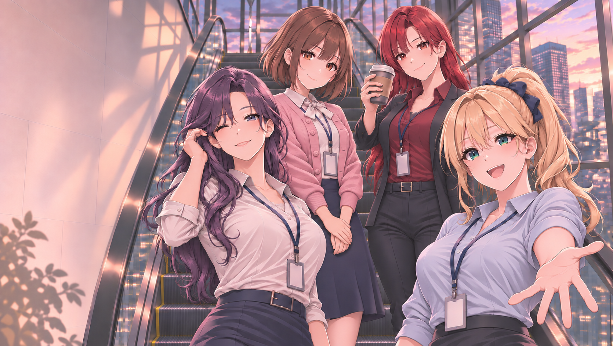

# 타이틀 키 비주얼 · 2026-11-04

현재 외형 기준·보관본: [title_escalator_jihyun_arm_lowered_v002.png](assets/title/title_escalator_jihyun_arm_lowered_v002.png)

## 외형 기준 지정 · 2026-11-04

사용자 요청에 따라 이 사진을 네 히로인의 현행 외형·업무복·공통 작화 기준으로 지정했다. [통합 외형 기준](APPEARANCE_CURRENT.md) 및 [리아](character_art_02_RIA.md)·[지현](character_art_03_JIHYUN.md)·[유진](character_art_04_YUJIN.md)·[서윤](character_art_05_SEOYUN.md) 문서에 얼굴·헤어·의상·사원증과 미확인 범위를 반영했다. 이전 개별 마스터와 충돌하면 이 기준을 우선한다. 인물의 성격·나이·직무·대본은 유지한다.

## 현재 버전 · v002
- 백지현이 허리에 얹던 팔을 몸 옆으로 자연스럽게 내린 자세로 변경.
- 내린 아래팔과 손은 앞에 있는 강리아의 머리·어깨·몸 뒤에 가려지는 구도.
- 기존 허리 손을 제거하고 블라우스·재킷·바지 부분을 이어서 정리.
- 직전 수정본의 얼굴, 헤어, 강리아 눈화장, 차유진 머리 리본 제거·턱선·손 자세와 색감을 기준으로 참조 편집.
- 생성 원본: `exec-7186021c-0b80-4df5-9278-fa12f1191aa4.png`

## 파일 정보
- 형식: PNG
- 실제 크기: 1670 × 942
- 크기: 2312210 bytes
- SHA-256: `8c6966a5dd2ae5da06cb1db17370baab5ae94049d00ebc7d8d441513a7c677a1`
- Git blob SHA: `7a973aa50fe2feb4edca481949f284a269ce496b`
- 제작: 참조 이미지 기반 이미지 생성 도구 편집. 도구가 모델명을 제공하지 않아 모델명은 추정하지 않음.

## 이전 보관본
- [v001 · 손·눈화장·팔 연결 수정본](assets/title/title_escalator_hands_ria_eyes_v001.png)
- v001은 이력으로 유지하며 현재 보관본은 위의 v002를 따른다.

## 적용 범위
타이틀 이미지와 새 외형 기준 문서의 보관이다. 합쳐진 평면 PNG이며 새 외형의 개별 입상·파츠 제작 완료를 뜻하지 않는다. 게임 실행 파일과 타이틀 UI 코드는 변경하지 않았다. 게임 표시 크기 변환·UI 배치·최종 인게임 검수는 별도 작업이다.
