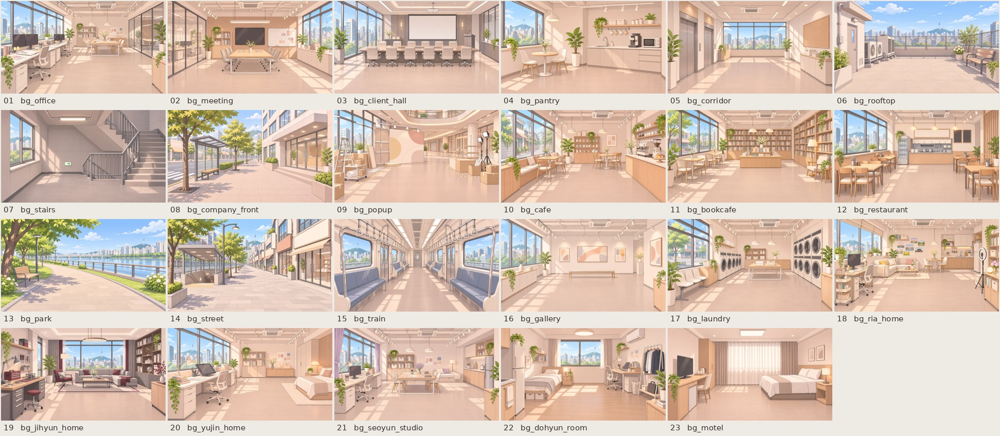

# 배경 낮판 후보 23장

## 남산타워 제거 12장

[전후 비교 · 왼쪽 원본 / 오른쪽 수정본](bg_tower_comparison.jpg)

| 파일 | 수정 이유 | 참고 그림 | SHA-256 |
|---|---|---|---|
| [bg_bookcafe_day_v004.png](bg_bookcafe_day_v004.png) | 창밖·원경의 남산타워 제거 | `CharacterArt/candidates/bg-chatgpt-v001/bg_bookcafe_day_v003.png` `CharacterArt/candidates/heroine-masters-v001/final_2048x3072/ria_office_pose01_neutral_v001.png` | `b744d65637a91d06a8726e9b559e425d379565bd9567f7dcf4d5c97844355349` |
| [bg_company_front_day_v004.png](bg_company_front_day_v004.png) | 창밖·원경의 남산타워 제거 | `CharacterArt/candidates/bg-chatgpt-v001/bg_company_front_day_v003.png` `CharacterArt/candidates/heroine-masters-v001/final_2048x3072/ria_office_pose01_neutral_v001.png` | `5d1763d77722ee778859d9d6d586386c437bcba913ce4a33e8234c2f6a4ec223` |
| [bg_corridor_day_v004.png](bg_corridor_day_v004.png) | 창밖·원경의 남산타워 제거 | `CharacterArt/candidates/bg-chatgpt-v001/bg_corridor_day_v003.png` `CharacterArt/candidates/heroine-masters-v001/final_2048x3072/ria_office_pose01_neutral_v001.png` | `8b749f64d6df45913c206e18e266d6b03db4fd54a872794cc4af3d36e56ee620` |
| [bg_dohyun_room_day_v004.png](bg_dohyun_room_day_v004.png) | 창밖·원경의 남산타워 제거 | `CharacterArt/candidates/bg-chatgpt-v001/bg_dohyun_room_day_v003.png` `CharacterArt/candidates/heroine-masters-v001/final_2048x3072/ria_office_pose01_neutral_v001.png` | `4909c5a2663130df8c96a5b8b9d87e7a34e2754177e329058c34a6e80ef5f42a` |
| [bg_gallery_day_v004.png](bg_gallery_day_v004.png) | 창밖·원경의 남산타워 제거 | `CharacterArt/candidates/bg-chatgpt-v001/bg_gallery_day_v003.png` `CharacterArt/candidates/heroine-masters-v001/final_2048x3072/ria_office_pose01_neutral_v001.png` | `ccbb6e56f47b50b85f122e57c180623f014a99b26e6d5a009d46268dbe5b35bd` |
| [bg_meeting_day_v004.png](bg_meeting_day_v004.png) | 창밖·원경의 남산타워 제거 | `CharacterArt/candidates/bg-chatgpt-v001/bg_meeting_day_v003.png` `CharacterArt/candidates/heroine-masters-v001/final_2048x3072/ria_office_pose01_neutral_v001.png` | `6b02497735ec3f619c159ba78fb70b01b8f799615b4f455144084706459e9e79` |
| [bg_office_day_v004.png](bg_office_day_v004.png) | 창밖·원경의 남산타워 제거 | `CharacterArt/candidates/bg-chatgpt-v001/bg_office_day_v003.png` `CharacterArt/candidates/heroine-masters-v001/final_2048x3072/ria_office_pose01_neutral_v001.png` | `037de98d650cdf34966759a3621236fa609d055a68674c40064c4a807cea1920` |
| [bg_pantry_day_v004.png](bg_pantry_day_v004.png) | 창밖·원경의 남산타워 제거 | `CharacterArt/candidates/bg-chatgpt-v001/bg_pantry_day_v003.png` `CharacterArt/candidates/heroine-masters-v001/final_2048x3072/ria_office_pose01_neutral_v001.png` | `3eaed3731e85fa63059600438134f0d3caa1d6d9b6a1d6d4fc25f2f688ca370e` |
| [bg_stairs_day_v004.png](bg_stairs_day_v004.png) | 창밖·원경의 남산타워 제거 (두 곳) | `CharacterArt/candidates/bg-chatgpt-v001/bg_stairs_day_v003.png` `CharacterArt/candidates/heroine-masters-v001/final_2048x3072/ria_office_pose01_neutral_v001.png` | `92898815828525f94bf0007e1d05214a8d6b0759ac341773b31b706585d17b3c` |
| [bg_street_day_v004.png](bg_street_day_v004.png) | 창밖·원경의 남산타워 제거 | `CharacterArt/candidates/bg-chatgpt-v001/bg_street_day_v003.png` `CharacterArt/candidates/heroine-masters-v001/final_2048x3072/ria_office_pose01_neutral_v001.png` | `dac8681222db44d18c588d38c9ac93444a54eeb7d18494d635c893217686012e` |
| [bg_train_day_v004.png](bg_train_day_v004.png) | 창밖·원경의 남산타워 제거 | `CharacterArt/candidates/bg-chatgpt-v001/bg_train_day_v003.png` `CharacterArt/candidates/heroine-masters-v001/final_2048x3072/ria_office_pose01_neutral_v001.png` | `508f8f8ffb42324c07e9bfd586662313beae0a2da97ab3993f73a907db33a954` |
| [bg_seoyun_studio_day_v004.png](bg_seoyun_studio_day_v004.png) | 창밖·원경의 남산타워 제거 | `CharacterArt/candidates/bg-chatgpt-v001/bg_seoyun_studio_day_v003.png` `CharacterArt/candidates/heroine-masters-v001/final_2048x3072/ria_office_pose01_neutral_v001.png` | `b3837b752ec542b054b3ae934b49e664072e13da2a8f660dceaa0695ac723be9` |

## v003 그림체 통일 23장

[v001·v002 대 v003 비교 사진](bg_style_v003.jpg)

2026-11-19 로컬 ComfyUI로 입력 그림을 입상 그림체에 맞춰 img2img 변환했다. 설정 기준은 [Docs/backgrounds-title-plan-v001.md](../../../Docs/backgrounds-title-plan-v001.md) 4절, 일괄 처리는 `Source/tools/comfy_batch_backgrounds.py`(장소별 고정 시드).

- 체크포인트: Anima Turbo 1.1 (`anima-turbo-v1.1.safetensors`), 텍스트 인코더 `qwen_3_06b_base`, VAE `qwen_image_vae`
- 샘플러: euler / simple, 10스텝, CFG 1 (마스터 워크플로와 같음), denoise 0.30
- ControlNet: Anima ControlNet-LLLite `anima-lllite-lineart-1` 0.85(끝 0.8, 전처리 Lineart anime) + `anima-lllite-depth-1` 0.5(전처리 Depth Anything 3 mono large)
- 그림체 참조: `ria_office_pose01_neutral_v001.png`(회색 바탕 합성), Anima IP-Adapter `anima-ria-ip-adapter` 강도 0.55. Anima용 IP-Adapter에는 style transfer 방식이 없어 강도로만 적용했다.
- 해상도: VRAM 8GB라 1344×768로 처리 → RealESRGAN x4 anime 6B → 1920×1080
- 부정 프롬프트는 넣었지만 CFG 1이라 효과가 없다. 23장 모두 사람·글자가 새로 생기지 않았음을 눈으로 확인했다.
- 후처리: 변환에서 바뀐 창밖 랜드마크 9장은 해당 부분만 입력 그림에서 부드러운 경계로 되살렸다(아래 표).

| 번호 | 파일 | 장소 | 입력 | denoise | 후처리 | SHA-256 |
|---:|---|---|---|---:|---|---|
| 1 | [bg_office_day_v003.png](bg_office_day_v003.png) | 브랜딩 회사 사무실 | bg_office_day_v001.png | 0.30 | 창밖 남산(N서울타워) 부분을 입력 그림에서 되살림 | <code>a99bbd32cc5442d1b94b205c3a74bf5bc13f2ccd83db5455553a6bd2b3c71010</code> |
| 2 | [bg_meeting_day_v003.png](bg_meeting_day_v003.png) | 사내 회의실 | bg_meeting_day_v001.png | 0.30 | 창밖 남산(N서울타워) 부분을 입력 그림에서 되살림 | <code>b529414a6d62c8094b227aff51a947ef96e654ffb0f06d59bbd2078adf1703bb</code> |
| 3 | [bg_client_hall_day_v003.png](bg_client_hall_day_v003.png) | 대기업 대회의실 | bg_client_hall_day_v001.png | 0.30 | 없음 | <code>7e200d371e481ed688a2674f89ff81dca5a4473f3f2d8d4a4a78e340b44ebe84</code> |
| 4 | [bg_pantry_day_v003.png](bg_pantry_day_v003.png) | 회사 탕비실 | bg_pantry_day_v001.png | 0.30 | 창밖 남산(N서울타워) 부분을 입력 그림에서 되살림 | <code>5dea83d198a588b080e1b97fa1808b6fb4f13ef9e7ed5d70976ca57506e0a3bc</code> |
| 5 | [bg_corridor_day_v003.png](bg_corridor_day_v003.png) | 회사 3층 복도 | bg_corridor_day_v001.png | 0.30 | 없음 | <code>67bb3ccf36e1dddaf1100fa7bb0a67b0a0111a9d1f3e4c6d499dd5956d610d79</code> |
| 6 | [bg_rooftop_day_v003.png](bg_rooftop_day_v003.png) | 회사 옥상 | bg_rooftop_day_v001.png | 0.30 | 없음 | <code>641f3404ab9a4ce1a42bf79969f9cc58227304671283fb7188b3c8687cbdcdd7</code> |
| 7 | [bg_stairs_day_v003.png](bg_stairs_day_v003.png) | 비상계단 층계참 | bg_stairs_day_v001.png | 0.30 | 창밖 전체와 비상구 표시를 입력 그림에서 되살림 | <code>1f70e1b298dc61fa604f164f76810df86177d5d9c8b12864364a99e2cd2c9a97</code> |
| 8 | [bg_company_front_day_v003.png](bg_company_front_day_v003.png) | 회사 앞 인도 | bg_company_front_day_v001.png | 0.30 | 원경 남산(N서울타워) 부분을 입력 그림에서 되살림 | <code>5da316a74bfb6e121a7f2c8f0854c63016223db8895b2b07600b10b4a1d908a8</code> |
| 9 | [bg_popup_day_v003.png](bg_popup_day_v003.png) | 팝업 스토어 준비 현장 | bg_popup_day_v001.png | 0.30 | 없음 | <code>2780b141f2e4fb5bead7f02e3cb0c73c331baaaca0ff03217c677a0e45536072</code> |
| 10 | [bg_cafe_day_v003.png](bg_cafe_day_v003.png) | 동네 카페 | bg_cafe_day_v001.png | 0.30 | 없음 | <code>e1fd4e264b2401da9547ccb905a8b01b3f7edb066cedf6bfc0b2394f32d4cd29</code> |
| 11 | [bg_bookcafe_day_v003.png](bg_bookcafe_day_v003.png) | 서점 겸 북카페 | bg_bookcafe_day_v001.png | 0.30 | 창밖 남산(N서울타워) 부분을 입력 그림에서 되살림 | <code>99fe44c2e8cd7b68ffad163f6ec603ce55b77c5e93b72ca35aa174c9b55f6790</code> |
| 12 | [bg_restaurant_day_v003.png](bg_restaurant_day_v003.png) | 동네 식당 | bg_restaurant_day_v002.png | 0.30 | 없음 | <code>92bd672a9b1ebe1b2b9d0e3d6086b0bd828b91d44483ed2f68857352a27b5466</code> |
| 13 | [bg_park_day_v003.png](bg_park_day_v003.png) | 강변 공원 산책길 | bg_park_day_v001.png | 0.30 | 원경 남산(N서울타워) 부분을 입력 그림에서 되살림 | <code>66ef49f15283499918ae3a6fda1508093d6f187c5c6915c571f605c6921d3eed</code> |
| 14 | [bg_street_day_v003.png](bg_street_day_v003.png) | 지하철역 앞 거리 | bg_street_day_v001.png | 0.30 | 없음 | <code>1b10fa696006689e90d76841769b2d38d949484634a56b5cb24e471b51d093b3</code> |
| 15 | [bg_train_day_v003.png](bg_train_day_v003.png) | 지하철 객차 | bg_train_day_v001.png | 0.30 | 없음 | <code>f3efc3f777857680fc152b3449108ff0ac83c0c9c0d5036f936d6f45ea208048</code> |
| 16 | [bg_gallery_day_v003.png](bg_gallery_day_v003.png) | 독립 전시 공간 | bg_gallery_day_v001.png | 0.30 | 창밖 남산(N서울타워) 부분을 입력 그림에서 되살림 | <code>46c32c8bfd2ed2128fe6ba8ca8c07c51a3e8bfdacf9c9f0089d61d31dcabd2e3</code> |
| 17 | [bg_laundry_day_v003.png](bg_laundry_day_v003.png) | 코인 세탁방 | bg_laundry_day_v001.png | 0.30 | 없음 | <code>ba60b1e68021c9d8740870b6664bfb41a2235bd77662f308cc5ceb0a57388807</code> |
| 18 | [bg_ria_home_day_v003.png](bg_ria_home_day_v003.png) | 리아의 원룸 | bg_ria_home_day_v002.png | 0.30 | 없음 | <code>c4be1bc77fc6a52513cff7f8ceb132000243ccd0f75dc01c639545380165070f</code> |
| 19 | [bg_jihyun_home_day_v003.png](bg_jihyun_home_day_v003.png) | 지현의 아파트 | bg_jihyun_home_day_v002.png | 0.30 | 없음 | <code>07028ee3ae177882ba837f469226b61f7818384bb45b83f7425bb43270b80b7e</code> |
| 20 | [bg_yujin_home_day_v003.png](bg_yujin_home_day_v003.png) | 유진의 원룸 | bg_yujin_home_day_v002.png | 0.30 | 없음 | <code>418095ca91695b809556f3230a72eb8d1b27c139fcfe9fa7363d56b186e16068</code> |
| 21 | [bg_seoyun_studio_day_v003.png](bg_seoyun_studio_day_v003.png) | 서윤의 작업실 겸 집 | bg_seoyun_studio_day_v002.png | 0.30 | 없음 | <code>a1a9f26ae2d1537438ebd2139bbb492e7064034250dc6639fda512d02f950ce7</code> |
| 22 | [bg_dohyun_room_day_v003.png](bg_dohyun_room_day_v003.png) | 도현의 원룸 | bg_dohyun_room_day_v001.png | 0.30 | 창밖 남산(N서울타워) 부분을 입력 그림에서 되살림 | <code>278eff1a99d92014a76d096473f50dd4d988ef44e4a69484486d2dd38df6237c</code> |
| 23 | [bg_motel_day_v003.png](bg_motel_day_v003.png) | 역 앞 비즈니스 모텔 | bg_motel_day_v001.png | 0.30 | 없음 | <code>30b500042387469ad0837e8169cbe4557b42dd2660e2c6feae937e817c8fdf65</code> |

## v002 수정 후보 5장

[v001·v002 전후 비교 사진](bg_fixes_v002.jpg)

재생성 횟수는 각 v001 이후 새로 생성한 횟수다.

| 파일 | 장소 | 재생성 횟수 | 남은 문제 | SHA-256 |
|---|---|---:|---|---|
| [bg_ria_home_day_v002.png](bg_ria_home_day_v002.png) | 리아의 원룸 | 1 | 시각 검수에서 발견된 문제 없음 | <code>9e342a04cc854abb4f5ee4c6b509b5803aa052cb68724c4178347a263c0bc06b</code> |
| [bg_yujin_home_day_v002.png](bg_yujin_home_day_v002.png) | 유진의 원룸 | 1 | 시각 검수에서 발견된 문제 없음 | <code>246d01b23d2172668c55937e09d1aeb28f56bd88200aa9f592db2147508cabd3</code> |
| [bg_seoyun_studio_day_v002.png](bg_seoyun_studio_day_v002.png) | 서윤의 작업실 겸 집 | 1 | 시각 검수에서 발견된 문제 없음 | <code>97a906859620c8174c90d0d880e7c1bd3b5a2a96fc46910890c214eff5f62c00</code> |
| [bg_restaurant_day_v002.png](bg_restaurant_day_v002.png) | 동네 식당 겸 포차 | 1 | 시각 검수에서 발견된 문제 없음 | <code>0be95d28adddef934b0195b97d55efc606b096c6a666da3d2d019a1c617516b3</code> |
| [bg_jihyun_home_day_v002.png](bg_jihyun_home_day_v002.png) | 지현의 아파트 | 1 | 시각 검수에서 발견된 문제 없음 | <code>994835a890ac1e2215426fe9b0f0c29782736643f3fe5547123f1161ce8fa7a9</code> |

## v001 낮판 23장

그림체 참조는 `claude/heroine-sprites`의 커밋 `9635af678eeeb8edd9d0df547805b8fbbcf8bf2a`에 있는 `Source/game/images/characters/ria/ria_office_pose01_neutral.png`이다. 2~23번에는 1번 사무실 완성본을 함께 사용했다.

| 번호 | 파일 | 장소 | 재생성 횟수 | 남은 문제 | SHA-256 |
|---:|---|---|---:|---|---|
| 1 | [bg_office_day_v001.png](bg_office_day_v001.png) | 브랜딩 회사 사무실 | 0 | 검수에서 발견된 문제 없음 | <code>85a2bd5e14b112edb21fcda43ae851b435120680aec2b499c3e1b1f74bd7f21a</code> |
| 2 | [bg_meeting_day_v001.png](bg_meeting_day_v001.png) | 사내 회의실 | 0 | 검수에서 발견된 문제 없음 | <code>acefdc3dee53791e9be7505f21e82807a89d0e15fd9ad96b6640c7749bacf90a</code> |
| 3 | [bg_client_hall_day_v001.png](bg_client_hall_day_v001.png) | 대기업 대회의실 | 0 | 검수에서 발견된 문제 없음 | <code>ddf8c4374fb790e60f5d9b95cba2cab5b01fbdd723361c564a2951c138a2c19d</code> |
| 4 | [bg_pantry_day_v001.png](bg_pantry_day_v001.png) | 회사 탕비실 | 0 | 검수에서 발견된 문제 없음 | <code>f047a190fe14ca45aee9659fe8542e95c1c3bd0bd74f1ffbb2f8e3a2fa98ae6e</code> |
| 5 | [bg_corridor_day_v001.png](bg_corridor_day_v001.png) | 회사 3층 복도 | 0 | 검수에서 발견된 문제 없음 | <code>273c671d6600559f232db3d6d4b1f448737bb1276b014dcb6803bd539d6f092c</code> |
| 6 | [bg_rooftop_day_v001.png](bg_rooftop_day_v001.png) | 회사 옥상 | 0 | 검수에서 발견된 문제 없음 | <code>d6626ed2bfe550932efaf10892e44a9bfa76d275a98107d1fdab69a5a90eda54</code> |
| 7 | [bg_stairs_day_v001.png](bg_stairs_day_v001.png) | 비상계단 층계참 | 0 | 검수에서 발견된 문제 없음 | <code>b9ee4592871c7ea4bd625d49bd90f0beeb79a2966427862a65e49cb0960cce96</code> |
| 8 | [bg_company_front_day_v001.png](bg_company_front_day_v001.png) | 회사 앞 인도 | 0 | 검수에서 발견된 문제 없음 | <code>997df7222798ebdde6535a96c5a6e2220c1e92ce706533338d309c84e56bdf6d</code> |
| 9 | [bg_popup_day_v001.png](bg_popup_day_v001.png) | 팝업 스토어 준비 현장 | 0 | 검수에서 발견된 문제 없음 | <code>5ee52b516632f11f715f6eafc32241a1621c16316a8c3703088a753b0fdb56e6</code> |
| 10 | [bg_cafe_day_v001.png](bg_cafe_day_v001.png) | 동네 카페 | 0 | 검수에서 발견된 문제 없음 | <code>be62c7cfd7f431cd0fee6137e24ee8c10c1e644e81a960cbeb88e64d53051896</code> |
| 11 | [bg_bookcafe_day_v001.png](bg_bookcafe_day_v001.png) | 서점 겸 북카페 | 0 | 검수에서 발견된 문제 없음 | <code>ce91d69c3d3b7681188603cdc8c0beb1ef856cdf461bb8a31164f008ca7408cb</code> |
| 12 | [bg_restaurant_day_v001.png](bg_restaurant_day_v001.png) | 동네 식당 | 0 | 검수에서 발견된 문제 없음 | <code>cd9a765214e484ba002efe9479c2f5f1c82222b28e7d1d6f8fc203ad1bf0f751</code> |
| 13 | [bg_park_day_v001.png](bg_park_day_v001.png) | 강변 공원 산책길 | 0 | 검수에서 발견된 문제 없음 | <code>cb70bb74348ea464926b55411a3c326c473209f064a7b0b1fc6758d4aaf63b2f</code> |
| 14 | [bg_street_day_v001.png](bg_street_day_v001.png) | 지하철역 앞 거리 | 0 | 검수에서 발견된 문제 없음 | <code>65c349ce0798459085da2a25d1cf036ded5d5d0dd22e7d047fec2f16b95b0501</code> |
| 15 | [bg_train_day_v001.png](bg_train_day_v001.png) | 지하철 객차 | 1 | 초안에 있던 객차 안 화분을 재생성으로 제거. 최종본에서 발견된 문제 없음 | <code>970552239e0854173bb9baf7d6152f18fa9c53838649c83c871ccbb9c4ef29ed</code> |
| 16 | [bg_gallery_day_v001.png](bg_gallery_day_v001.png) | 독립 전시 공간 | 0 | 검수에서 발견된 문제 없음 | <code>b3faa7d1ac8e02e6fdcd688278f29496f40af36f671eac1830e72edd64f442f6</code> |
| 17 | [bg_laundry_day_v001.png](bg_laundry_day_v001.png) | 코인 세탁방 | 0 | 검수에서 발견된 문제 없음 | <code>400771c4ebefac937be4e994995dd3262965a69dfdfd4716030bcb8eddd04cdb</code> |
| 18 | [bg_ria_home_day_v001.png](bg_ria_home_day_v001.png) | 리아의 원룸 | 0 | 검수에서 발견된 문제 없음 | <code>6470c0043151408bac4856dac797c3e5327b6bd5f5b5fc5c4e25b54a401eb75a</code> |
| 19 | [bg_jihyun_home_day_v001.png](bg_jihyun_home_day_v001.png) | 지현의 아파트 | 0 | 검수에서 발견된 문제 없음 | <code>52df23f7cef9bc9797565b3692f2d253766ccb8ecfd86ad4f7db9dc3761529d7</code> |
| 20 | [bg_yujin_home_day_v001.png](bg_yujin_home_day_v001.png) | 유진의 원룸 | 0 | 검수에서 발견된 문제 없음 | <code>d472567364f26fdb1c3d3e591821883c58cf9075a7802e8915eae3fb4e3cfdde</code> |
| 21 | [bg_seoyun_studio_day_v001.png](bg_seoyun_studio_day_v001.png) | 서윤의 작업실 겸 집 | 0 | 검수에서 발견된 문제 없음 | <code>2f65fd965cac56519916272d84c7c474558ba74fe8cf854d841aae247047d90c</code> |
| 22 | [bg_dohyun_room_day_v001.png](bg_dohyun_room_day_v001.png) | 도현의 원룸 | 0 | 검수에서 발견된 문제 없음 | <code>bb04272b6ca037a3790c8f5364db450a2545e2da971f4317f2fe70abf9ffc3f2</code> |
| 23 | [bg_motel_day_v001.png](bg_motel_day_v001.png) | 역 앞 비즈니스 모텔 | 0 | 검수에서 발견된 문제 없음 | <code>e0e6706f35753769056d5ab91b32da1f63887bb459f2b1a146e8dabdeeb77413</code> |
