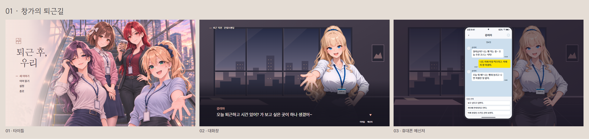

# 창가의 퇴근길

〈퇴근 후, 우리〉 UI 비교 시안 중 선택한 01번이다. 타이틀, 대화창, 휴대폰 메신저를 각각 16:9 게임 화면으로 보여준다.

## 화면 구성

- **타이틀**은 일러스트를 화면 전체에 깔고 왼쪽 벽에 창문 심볼, 두 줄 한글 제목, 세로 메뉴를 배치한다. 새 배경을 제작할 때는 화면 왼쪽 약 25%에 로고와 메뉴를 읽을 수 있는 낮은 대비의 여백을 남긴다. 인물 얼굴과 강한 반사광은 그 영역을 피한다.
- **대화창**은 장면 하단을 어둡게 깔고 화자 이름과 본문을 왼쪽에 정렬한다. 선택지는 화면 가운데에 세로로 놓는다. 새 배경을 적용할 때 밝은 장면과 어두운 장면에서 각각 대사 대비를 확인한다.
- **휴대폰 메신저**는 어둡게 비치는 장면 위에 세로형 기기를 띄운다. 시간, 와이파이, 배터리, 빈 원형 프로필, 발신자 이름을 표시한다. 보낸 말풍선은 노란색, 받은 말풍선은 흰색을 쓴다.

비교 이미지의 대화 배경은 배치를 확인하기 위한 임시 그래픽이다. 이 폴더는 디자인 검토용이며, 실제 Ren’Py 화면은 별도 적용 단계에서 확인한다.
